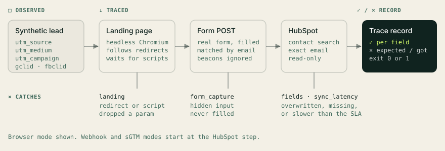

<p align="center">
  
</p>

<h1 align="center">LeadTrace</h1>

<p align="center">
  <strong>A paid click can reach HubSpot labeled as direct, and nothing in the pipeline throws an error. Send one synthetic lead through your landing page and form, and see the handoff where the attribution changed.</strong>
</p>

<p align="center">
  3 audit modes: browser, webhook, sGTM · 6 attribution fields checked per lead · 40 tests in CI on Python 3.9–3.12, 14 of them driving real headless Chrome · read-only on HubSpot · no runtime dependencies in the core CLI
</p>

<p align="center">
  <a href="https://github.com/ChristopherLandaverde/leadtrace/actions/workflows/ci.yml"></a>
  <a href="pyproject.toml"></a>
  <a href="LICENSE"></a>
</p>

<p align="center">
  <a href="#the-trace">The trace</a> · <a href="#scope">Scope</a> · <a href="#run-a-hubspot-audit">Run an audit</a> · <a href="#browser-form">Browser form</a> · <a href="#output">Output</a> · <a href="CHANGELOG.md">Changelog</a> · <a href="https://focosys.io">focosys.io ↗</a>
</p>

`CLI · Nov 2026 · v0.2.0 · Implementation notes, assumptions, and limits · Walkthrough / no client data`

LeadTrace is a command-line audit for marketing ops and RevOps engineers who need to trust the first-touch fields in HubSpot before reporting on them. By Christopher Landaverde, FOCO Systems. It sends one synthetic lead through your landing page and form, your form webhook, or your server-side GTM endpoint. It then checks whether HubSpot still holds the attribution the lead started with.

<p align="center">
  
  <br><sub>Browser mode shown. Check names match the report keys.</sub>
</p>

## The trace

```
□ OBSERVED   one synthetic lead with 6 attribution fields: ft_source, ft_medium,
             ft_campaign, original_conversion_id, gclid, fbclid
↓ TRACED     the landing page and form in headless Chrome, or one POST to your
             endpoint, then a HubSpot contact search by the exact email
× BROKEN     a redirect that drops a tracking param, a hidden input that is
             never filled, any field missing or changed in HubSpot, a contact
             that is missing or duplicated, or a sync slower than the SLA
✓ VERIFIED   a trace record on a terminal, JSON when piped, with expected and
             actual values for each check. Exit 0 = every check passed.
             Exit 1 = at least one failed.
```

## Scope

LeadTrace does:
- check landing-page redirects, hidden form inputs, and the HubSpot record
  the real form writes (`--mode browser`)
- check the server endpoint and the HubSpot record it writes
- check an sGTM receipt for the CAPI event it built (see below)

LeadTrace does not:
- handle multi-step forms, forms in iframes (including embedded HubSpot
  forms), CAPTCHAs, consent banners, or multipart form bodies
- confirm that Meta received the event
- look up Salesforce records or reconcile HubSpot with Salesforce (not in v1)

All test data is synthetic. Send it only to test portals and test
destinations.

## Why this exists

CRM merge and sync logic can overwrite first-touch values without raising
an error. One example: a field keeps whichever value was written last, not
the original UTM value. The report still says "paid", but the record
underneath has changed. LeadTrace catches the change at ingestion, before
anyone makes a budget decision from that report.

## Run a HubSpot audit

You need Python 3.9 or later. LeadTrace has no runtime dependencies beyond
the standard library.

```sh
python -m pip install .
```

1. Point a test webhook at a test HubSpot portal. The webhook must accept a
   flat JSON lead. In the portal, create contact properties for
   `ft_source`, `ft_medium`, `ft_campaign`, `original_conversion_id`,
   `gclid`, and `fbclid`.
2. Create a HubSpot private app token with the `crm.objects.contacts.read`
   scope. Set it as `HUBSPOT_ACCESS_TOKEN` in your environment.
3. Run the audit against your endpoint:

```sh
leadtrace audit https://your-test-endpoint.example/lead \
  --property ft_source=first_touch_source
```

If a HubSpot property uses a different internal name, map it with
`--property FIELD=INTERNAL_NAME`. You can repeat the flag.

The audit:
- sends one POST and expects HTTP 200 or 201
- searches HubSpot for the lead's exact synthetic email
- compares each field with the value it sent

| Limit | Default | Flag |
|---|---|---|
| SLA from dispatch to HubSpot `createdate` | 120 minutes | `--max-latency` |
| Time to wait for the contact to show up in search | 120 seconds | `--wait-seconds` (`7200` = 2 hours) |
| Time between searches | 5 seconds | `--poll-seconds` |

If the contact is not in search results by the deadline, the audit reports
a timeout.

### Output

On a terminal, `audit` prints a trace record. When piped or run in CI, it
prints JSON. `--format json` or `--format trace` forces one or the other.
Real output from the local test site: a redirect drops `gclid` before the
form loads (synthetic data, no client data):

```
LEADTRACE / AUDIT
browser mode · 2026-11-22 14:51 UTC · synthetic lead, test data only

□ OBSERVED   lead foco_1795359099_206acde95f0a418eaa95ce6…
             foco_test+foco_1795359099_206acde95f0a418eaa95ce61aa2ea070@test.focosys.io
↓ TRACED     landing page → form POST → HubSpot contact search

× landing                 dropped on the way: gclid
× form_capture            POST http://127.0.0.1:43269/submit · HTTP 200 · gclid: expected gclid_syn_foco_17953590…, got ""
✓ destination_lookup      one contact, exact email
✓ ft_source               google_ads
✓ ft_medium               cpc
✓ ft_campaign             audit_test
✓ original_conversion_id  conv_page_1173305d641858
× gclid                   expected gclid_syn_foco_1795359099_206…, got ""
✓ fbclid                  fbclid_syn_foco_1795359099_206acde95f0a418eaa95…
✓ sync_latency            0.0 min (SLA 120 min)

× BROKEN     3 of 10 checks failed
```

Status color (red `×`, green `✓`) shows only on a TTY and respects
`NO_COLOR`. `verify` and `inject` print the same kind of record.

### Browser form

`--mode browser` runs the path a real ad click takes. Install the extra
first:

```sh
python -m pip install '.[browser]'
python -m playwright install chromium   # or point --browser-path at Chrome
```

```sh
leadtrace audit https://staging.example.com/demo \
  --mode browser \
  --form-field ft_campaign=campaign_hidden
```

LeadTrace:
1. Adds `utm_source`, `utm_medium`, `utm_campaign`, `gclid`, and `fbclid` to
   the URL and opens it in headless Chromium. It follows redirects.
2. Check `landing`: the page URL at submit time must still carry all 5
   params. It is read after the network settles, so scripts that strip
   params after load are caught. The report lists any that were dropped.
3. Fills `email`, `firstname`, `lastname`, `phone`, and `company` by
   `[name=...]` (change these with `--selector FIELD=CSS`), then clicks
   `--submit` (default `[type=submit]`).
4. Check `form_capture`: the form POST is the first POST after the click
   whose body carries the synthetic email. Analytics beacons and pixels are
   listed in `other_posts` and are not mistaken for the form. That POST must
   carry each tracking value under the canonical name or its `utm_*` name.
   If the form uses other names, map them with `--form-field FIELD=NAME`.
   The report shows `submit_url`, so you can confirm the form posted where
   you expect.
5. Searches HubSpot and compares each field, as the other modes do. The page
   creates `original_conversion_id`, so HubSpot is compared with the value the
   form submitted.

The browser blocks requests to literal private and link-local IPs, such
as `169.254.169.254`. They are listed in `blocked_requests`. If the landing
page redirects to one, the run stops before the form. Playwright cannot
intercept redirect hops, so that one hop is still sent. Hostnames that
resolve to private ranges are not checked. Loopback stays allowed for local
test sites.

The form under test writes to HubSpot, so point it at a test portal. Exit code 2 means
Playwright or the browser binary is missing.

### sGTM receipt

Use `--mode sgtm` when your endpoint returns a JSON receipt with the
outbound CAPI event under `capi_event`. LeadTrace posts the same flat JSON
lead. Your endpoint sends it to HubSpot and builds the CAPI event.

LeadTrace then checks the receipt:
- `event_id` must match the lead's `original_conversion_id`
- `user_data.em` and `user_data.ph` must match the SHA-256 hashes of the
  synthetic email and phone

Return the event your server actually built, not a copy of the input. This
checks the receipt only. You need separate evidence that Meta received the
event.

## Local tools

```sh
leadtrace generate --format form
leadtrace inject dry-run --dry-run
leadtrace verify --expected fixtures/sample_lead.json --actual fixtures/sample_crm_record.json
leadtrace mcp
python -m unittest discover -s tests -v
```

- `generate` builds test payloads.
- `verify` compares fixture files offline.
- `mcp` runs the same tools as an MCP stdio server, so an agent can call
  them.
- `audit` is the only command that runs the strict HubSpot checks.

The test suite runs the audit against mocked webhook and HubSpot search
responses. It needs no live CRM credentials.

---

Built by Christopher Landaverde, FOCO Systems.
Field notes on this problem ↗ [focosys.io](https://focosys.io) ·
[christopher@focosys.io](mailto:christopher@focosys.io)
